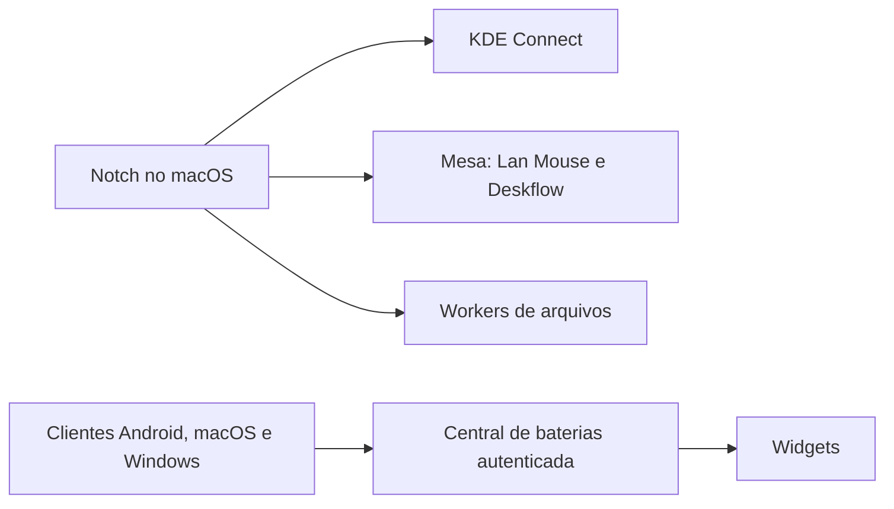

# Insight Notch

Uma central de produtividade para macOS, baseada no Boring Notch 2.7.3. Reúne mídia, arquivos, clipboard, atividade, uso de IA, dispositivos móveis e computadores remotos no painel do notch.

Esta documentação explica os recursos, a arquitetura e as etapas de configuração usando somente funções genéricas dos componentes. Credenciais, endereços, domínios, identificadores, nomes de equipamentos, comandos e caminhos de instalação ficam fora do texto.

## Recursos implementados

| Área | O que oferece |
| --- | --- |
| Home e mídia | Reprodução do macOS, capas com proteção contra atualizações atrasadas, reconexão do player, controles, calendário e recursos herdados de HUD, espelho e carregamento. |
| Shelf | Arrastar arquivos como anexos nativos, compartilhar textos e links, prévia rápida e integração com AirDrop. |
| Clipboard | Histórico pesquisável, itens fixados e limpeza dos não fixados. Control+V abre o histórico e Command+V mantém a colagem normal. Conteúdo marcado como confidencial é ignorado. |
| Links | Captura de links com título e observação opcionais, salva como Markdown em uma caixa de entrada do Obsidian. |
| Atividade | Eventos locais de tarefas, transferências e aplicativos, com progresso e conclusão. A integração com Dot pode ser ocultada sem removê-la. |
| Uso de IA | Janelas de Claude, Codex e Gemini, histórico e fontes locais adicionais de OpenCode quando disponíveis. Leituras antigas são identificadas. |
| Avisos de limites | Alertas em 80% e 95%, com deduplicação e respeito à renovação. Dados antigos e comparações relativas não disparam avisos de cota. |
| Mixer | Volume, mute e seleção de saída por aplicativo. |
| Prévia de janelas | Recurso opcional do Dock, desativado por padrão. Quando desativado, o monitoramento e o temporizador permanecem parados. |
| Dispositivos móveis | Bateria, carregamento, localização por toque, compartilhamento e transferências pelo KDE Connect. |
| Mensagens | Notificações encaminhadas para o sistema nativo do macOS e resposta pelo painel quando a origem oferece essa ação. |
| Mídia remota | Seleção de player, faixa anterior, reprodução, pausa e próxima faixa nos players expostos pelo KDE Connect. |
| Arquivos | Cópias acompanhadas, busca por nome em locais permitidos e recebimento de arquivos remotos. |
| Processamento | Filas persistentes para vídeo MP4, áudio M4A e transcrição local, com progresso, cancelamento e verificação de integridade. |
| Mesa contínua | Entrada bidirecional com Lan Mouse: teclados e mouses de cada computador podem controlar os demais. Mesmo Conectar/Pausar, disposição lateral e canal Deskflow por SSH. |
| Apps Android | Espelhamento e aplicativos em janelas com scrcpy, listagem de apps, ícones próprios e encerramento das janelas temporárias. |
| Recuperação de depuração | Helper Android opcional para tentar recuperar a depuração sem fio após mudanças de rede, respeitando pausa e autorizações do sistema. |
| Telemetria | Recursos locais do macOS e sondas SSH para Linux, Windows, armazenamento e virtualização, além de feeds opcionais de serviços e alertas. |
| Widgets de bateria | Widget separado no macOS para quatro perfis móveis e widget Android com seis perfis da implementação atual, em uma linha ou duas. |
| Interface | Painéis compactos, blocos separados de mídia e ações, vidro escuro opcional e proteção contra recolhimento pelo gesto vertical nas áreas com rolagem. |

Os módulos são opcionais. Recursos locais funcionam sem configurar computadores remotos ou dispositivos móveis. A versão atual conserva tabelas de perfis no código; configurar outro ambiente exige adaptar essas tabelas, e não apenas mudar rótulos na interface.

## Como a solução foi organizada

O painel macOS coordena a interface. Helpers independentes cuidam das conexões, coleta de dados e operações demoradas, mantendo o trabalho fora da thread principal.

- KDE Connect mantém o pareamento e oferece notificações, mídia, bateria e compartilhamento.
- SSH transporta comandos controlados e arquivos entre o painel e os destinos autorizados.
- A Mesa coordena Lan Mouse para entrada bidirecional e mantém o canal Deskflow por conexões privadas. O modo anterior do Deskflow continua disponível quando a integração não está configurada.
- Workers executam conversões, transcrição e busca, com estado persistente por trabalho.
- A central de baterias recebe dados de cada cliente diretamente. Os dispositivos móveis não dependem do computador macOS acordado para sincronizar entre si.

As integrações não representam uma descoberta universal de qualquer equipamento. Identificação de dispositivos, destinos, recursos pesquisáveis e ferramentas disponíveis precisam corresponder à instalação de cada pessoa.

## Preparação e instalação

### Aplicação macOS

1. Prepare Xcode com um SDK compatível com as APIs do projeto. O target principal declara macOS 14; algumas funções de captura e áudio exigem versões mais recentes.
2. Prepare Node.js, npm e Python 3 para os helpers usados pelas integrações.
3. Revise os destinos, perfis e preferências da sua própria instalação antes de compilar.
4. Instale as dependências Node e compile o projeto principal no Xcode em configuração Release.
5. Execute as verificações fornecidas pelo projeto antes de substituir a instalação existente.
6. Use o instalador do projeto para fazer backup, copiar os helpers, assinar localmente e registrar a aplicação.
7. Ative a inicialização ao entrar no sistema nas configurações do app.

A assinatura local pode exigir nova autorização de privacidade após uma recompilação. Uma distribuição original do Boring Notch não inclui os recursos desta edição.

### Componentes opcionais

| Integração | Preparação necessária |
| --- | --- |
| Dispositivos móveis | KDE Connect nas duas pontas e pareamento confirmado pelo usuário. |
| Janelas Android | Android Platform Tools, scrcpy e depuração autorizada. |
| Helpers Android | JDK 21, plataforma Android API 36 e Build Tools correspondentes. |
| Mesa contínua | Deskflow e, para entrada bidirecional, Lan Mouse nos sistemas participantes, com permissões de entrada. |
| Processamento | Python 3 nos destinos e FFmpeg para áudio e vídeo. |
| Transcrição | Ambiente Python com faster-whisper e modelo compatível disponível localmente. |
| Widget macOS | Projeto de widget compilado no Xcode; XcodeGen caso seja necessário regenerá-lo. |
| Baterias pela internet | Serviço Python com SQLite, publicação HTTPS e credencial independente por cliente. |

## Permissões

No macOS, autorize somente as funções que pretende usar:

- Acessibilidade para atalhos e interação assistida com janelas.
- Monitoramento de Entrada para o Deskflow, quando solicitado pelo sistema.
- Gravação de Tela e Áudio do Sistema para captura, prévias e funções de áudio que dependem dessa API.
- Notificações para os avisos encaminhados.
- Calendários e Lembretes para os recursos correspondentes.

O Deskflow precisa da própria autorização; a permissão concedida ao Notch não substitui a de outro processo. No Linux, confirme também os diálogos exigidos pela sessão gráfica.

Após uma nova build, reabra o aplicativo e teste a função. O controle de permissão estar habilitado não comprova, por si só, que a assinatura atual já está autorizada.

## Configurar dispositivos, mensagens e mídia

1. Abra o KDE Connect no computador e no dispositivo móvel.
2. Confirme o pareamento nas duas pontas.
3. Habilite os plugins de bateria, notificações, compartilhamento e mídia que deseja usar.
4. No Android, permita o acesso às notificações e selecione os aplicativos que podem encaminhá-las.
5. Associe os perfis internos aos seus próprios pareamentos e escolha rótulos locais.
6. Se utilizar um relay, prepare os helpers e dependências no usuário Linux que mantém a sessão do KDE Connect e confirme seu acesso SSH.

A árvore configurável aceita um ajuste local do relay e dos nomes visíveis. Nos módulos que mantêm tabelas fixas, personalize o código e recompile. Não existe um único formulário que configure todas as integrações.

O encaminhamento nativo substitui somente o popup duplicado que está sendo gerenciado e tenta restaurar a configuração anterior ao parar. Respostas dependem da ação disponibilizada pela notificação original; nem toda mensagem oferece essa possibilidade.

A mídia local continua usando a integração do macOS. O controle remoto depende dos players expostos pelo KDE Connect. O Mixer permite ajustar volume e saída por aplicativo sem exigir um cliente específico para cada serviço de streaming.

O controlador dedicado de mídia retoma a conexão após interrupções e reabertura do player. Eventos de progresso reutilizam a capa atual; respostas atrasadas de faixas anteriores são descartadas. A análise de cor usa uma amostra pequena da imagem para reduzir processamento sem alterar o visual dos controles.

A Shelf oferece arquivos ao aplicativo de destino como anexos nativos. Textos e links mantêm seus formatos próprios. Ao limpar a seleção, a prévia rápida também é fechada. A prévia de janelas do Dock pode ser habilitada pelo menu do aplicativo quando desejada.

## Configurar janelas Android e recuperação da depuração

1. Habilite as opções de desenvolvedor e a depuração sem fio no Android.
2. Faça o pareamento autorizado com o código exibido pelo sistema.
3. Confirme que o aparelho está acessível e associe seu perfil ao helper de espelhamento.
4. Prepare o scrcpy e compile o helper de ícones, caso deseje os ícones extraídos dos aplicativos.
5. Na interface do Notch, selecione o dispositivo e abra o espelhamento ou um app em janela.

As janelas de aplicativos usam um display virtual quando suportado. Cada janela recebe identidade visual própria e pode ser encerrada sem relançamento automático. Bloqueio, repouso ou restrições de captura podem impedir a imagem mesmo quando a conexão existe.

O helper opcional de recuperação funciona no próprio Android. Durante a instalação autorizada, ele recebe a permissão necessária para solicitar a alteração da configuração de depuração, além das permissões de notificação e execução em segundo plano. A exceção de otimização de bateria é limitada a esse app.

Ao detectar uma alteração de rede, o helper aguarda a estabilização e tenta recuperar a depuração com limite de tentativas. Há monitoramento periódico de fallback e retomada configurada após inicialização ou atualização do aplicativo. É possível pausar pelo app ou pela notificação.

As opções de desenvolvedor e de depuração necessárias devem continuar habilitadas. O Android mantém o controle sobre a confiança na rede e a autorização dos computadores. O helper não aprova redes novas, não troca a ROM, não faz root e não garante conexão contínua em qualquer condição.

## Configurar arquivos e processamento

1. Prepare um acesso SSH autorizado para cada destino.
2. Instale o worker no usuário que executará as tarefas e confirme o intérprete Python usado por ele.
3. Associe os destinos e os locais permitidos ao broker do Notch.
4. Instale FFmpeg para conversão e prepare o ambiente de transcrição quando necessário.
5. Defina os locais em que a busca pode procurar arquivos.
6. Confirme as capacidades do destino pela interface antes de enviar um trabalho.
7. No Windows, valide a execução pelo Agendador e sua continuidade após o encerramento da sessão SSH.

A área de arquivos reúne Cópias, Processar e Buscar arquivos. A busca usa nomes e metadados em locais limitados. A fila é ordenada por destino e preserva progresso, conclusão, cancelamento e falhas. O recebimento do resultado verifica SHA-256 antes de apresentá-lo como concluído.

A seleção de destino pode ser automática ou explícita. A transcrição atual usa CPU e um modelo previamente disponível. A execução depende de o destino permanecer acordado, acessível e com as ferramentas preparadas.

## Configurar a mesa contínua

1. Prepare os pacotes oficiais do Deskflow e do Lan Mouse em cada sistema, verificando a integridade dos arquivos recebidos.
2. Mantenha um perfil privado com os endereços dos participantes e uma identidade de certificado diferente para cada um. Autorize somente os certificados dos outros participantes; esses dados não fazem parte do repositório.
3. Defina a disposição lateral e confirme o acesso SSH usado pelo controlador e pelos túneis.
4. Autorize o compartilhamento de entrada em cada sistema. Preserve os certificados e a autorização de recebimento entre sessões.
5. No KDE compatível, a captura por layer-shell evita recriar o diálogo de captura; o recebimento por libei reaproveita o token de autorização salvo pelo sistema. Esse token deve permanecer privado e não deve ser copiado entre computadores.
6. Escolha a disposição na interface e inicie a sessão. O controlador prepara os mecanismos de entrada antes de retirar do Deskflow o encaminhamento pelas bordas. Se a ativação falhar, restaura o modo anterior.
7. Teste cada mouse e teclado nos outros computadores, inclusive a combinação de mouse de uma origem com teclado de outra no mesmo destino. Teste copiar/colar nos aplicativos usados.

O servidor do Deskflow escuta somente na interface local e seus clientes chegam por túneis SSH. O Lan Mouse usa um canal direto criptografado, com autorização por certificado. Um processo aberto não prova que o cliente esteja conectado.

Na integração bidirecional, Control+Option/Alt+Home devolve o controle à origem física daquele teclado. No modo anterior, Control+Option+Home solicita o retorno ao computador macOS. A interface indica o comportamento ativo. As bordas externas conectam diretamente as duas extremidades da disposição, formando um ciclo sem enviar eventos para dois destinos ao mesmo tempo.

Conectar/Pausar controla os componentes dos três sistemas. Pausar encerra os processos pertencentes à sessão, liberando teclas e ponteiros, mas preserva as identidades e autorizações salvas. Permissões revogadas, atualizações do sistema ou a troca de sessão gráfica podem exigir nova autorização.

No macOS, os mecanismos de entrada são iniciados pelo gerenciador da sessão gráfica, usando a autorização própria dos aplicativos. Assim, uma recompilação do Notch não substitui a identidade autorizada desses mecanismos. O token do KDE é mantido em armazenamento privado persistente e renovado após cada restauração bem-sucedida.

O Lan Mouse não fornece sincronização de clipboard. O canal Deskflow permanece conectado, mas seu clipboard depende da tela ativa no próprio Deskflow; a malha bidirecional de entrada ainda não garante copiar/colar entre todos os destinos.

No Windows, o cliente usa uma tarefa na sessão gráfica do usuário com um iniciador sem console. Não é necessário manter uma janela de terminal aberta. O iniciador acompanha o processo para que pausar a sessão também encerre o cliente corretamente.

## Configurar os widgets de bateria

### Central independente

A central usa Python e SQLite. Cada cliente envia apenas a própria porcentagem e o estado de carregamento, autenticado por uma credencial exclusiva. O servidor guarda o hash dessa credencial, vincula a escrita ao cliente e devolve o snapshot do conjunto autorizado.

Na implementação com publicação pela internet, um túnel ou proxy HTTPS, como Cloudflare Tunnel, conecta os clientes ao serviço privado. A central continua em um servidor disponível; o computador macOS deixa de ser intermediário obrigatório para os outros dispositivos.

Para configurar:

1. Personalize o conjunto de perfis e os rótulos nos componentes envolvidos.
2. Gere credenciais individuais fora do repositório e mantenha somente seus hashes na configuração do servidor.
3. Prepare o armazenamento persistente e a execução automática da central.
4. Configure a publicação HTTPS, a origem privada e as restrições de acesso.
5. Configure cada cliente com o destino da central e somente sua própria credencial.
6. Confirme que cada cliente publica a própria bateria e recebe o snapshot esperado.

### macOS

O widget é separado do widget nativo do sistema, preservando o uso deste para acessórios. A implementação atual mostra quatro perfis móveis no widget adicional.

Compile e instale o projeto do widget, configure o publicador local e adicione-o pela galeria do macOS. A inicialização por usuário mantém o publicador disponível após entrar no sistema. No modo com central independente, o antigo mecanismo de manter o computador acordado é desativado pelo instalador de serviços.

### Android

Compile o app, mantenha uma assinatura local consistente para futuras atualizações e instale-o pelos mecanismos de depuração já autorizados. O provisionamento protegido associa a credencial daquele cliente; os valores reais não são embutidos no APK.

Permita notificações e execução em segundo plano, confirme a conexão com a central e adicione o widget pelo launcher. A versão atual oferece seis perfis, ícones distintos e uma linha ou duas. Depois do provisionamento, a sincronização pela internet dispensa ADB.

### Windows

Prepare o Python, configure o publicador e execute o instalador com a conta responsável pela tarefa. O instalador protege a configuração local, verifica uma publicação e registra a execução ao ligar e ao entrar na conta, com recuperação após falha.

A leitura usa o estado nativo da bateria para distinguir carregamento de alimentação externa. O publicador não altera plano de energia, comportamento da tampa, ventoinhas ou suspensão.

### Atualização e repouso

Os publicadores de computadores usam ciclos de 30 segundos. O Android combina eventos de bateria e rede, um serviço visível com ciclo de 60 segundos e um job periódico de fallback. WidgetKit, economia de energia e restrições do sistema podem adiar a atualização visual ou a execução.

Leituras com mais de 180 segundos são marcadas como antigas ou offline. Sem internet, em repouso ou desligado, o cliente deixa de produzir uma leitura nova e os demais conservam o último valor. Uma tampa fechada só permite envio contínuo quando o sistema permanece acordado e conectado.

## Configurar uso de IA e atividade

- Codex usa o app-server autenticado localmente quando disponível.
- Claude utiliza as fontes locais e a sessão configurada para o usuário; o histórico do app pode complementar as leituras.
- Gemini utiliza o perfil autenticado do Microsoft Edge e o Chaves do macOS. A configuração privada associa o perfil à conta esperada por um hash, antes de consultar a cota. Os cookies necessários permanecem em memória e são enviados somente ao provedor. Não depende de uma janela aberta ou de Acessibilidade.
- OpenCode pode fornecer histórico local quando sua base estiver disponível.
- Preços e totais estimados dependem das leituras e da tabela disponível; não representam uma fatura do provedor.
- A atividade recebe eventos explícitos de tarefas e integrações. Ocultar Dot preserva os eventos de transferência.

Configure as sessões e as preferências localmente. Cotas de produtos diferentes não são intercambiáveis, e ausência de uma leitura não significa consumo zero. Contratos web de provedores podem mudar.

Para Links, selecione o diretório local do Obsidian nas preferências correspondentes. A captura exige um link válido e gera uma nota para análise posterior; não lê nem indexa automaticamente o conteúdo remoto.

## Telemetria e diagnóstico

A telemetria local coleta recursos do sistema. As sondas remotas usam SSH com destinos e identidades explícitos. Serviços, armazenamento e virtualização refletem os perfis configurados e não provisionam automaticamente uma infraestrutura.

| Sintoma | O que conferir |
| --- | --- |
| KDE Connect indisponível ou ServiceUnknown | Aplicativo aberto, sessão D-Bus correta, conexão local e relay autorizado. |
| Mensagem sem campo de resposta | Permissões, plugin ativo e ação de resposta na notificação original. |
| Player remoto vazio | Aplicativo em reprodução, plugin de mídia e conexão do dispositivo. |
| Janela Android sem imagem | Estado de bloqueio e repouso, transporte de depuração e suporte ao display virtual. |
| Depuração cai após mudança de rede | Pausa, permissões, descoberta e confiança da rede solicitada pelo Android. |
| Processamento indisponível | Acesso SSH, Python, worker, ferramentas e execução persistente no destino. |
| Mesa inicia sem controlar outro computador | Clientes conectados, permissões do Deskflow e disposição das telas. |
| Bateria não muda | Horário da leitura, internet e execução do publicador no próprio cliente. |
| Captura ou mixer indisponível | Permissões da versão atual do app e requisitos das APIs usadas. |
| Aplicação abre duplicada | Item de login e registros de cópias antigas. |

As verificações do projeto cobrem modelos, parsers, filas, transferências, notificações, fontes de uso e baterias. O helper de depuração possui verificações próprias da política de recuperação. Logs devem ser revisados antes de compartilhamento, pois podem conter conteúdo pessoal ou dados locais.

## Segurança e manutenção

As credenciais de cada instalação permanecem fora do código compartilhado. Pareamento, permissões de entrada e autorização de captura continuam sob controle do usuário e do sistema operacional.

A central de baterias limita campos, tamanho das requisições e frequência de acesso. Ela não recebe mensagens, clipboard ou arquivos. Os módulos de arquivo e processamento usam validação de destinos e locais permitidos.

Alterações na implementação exigem verificar os componentes afetados e recompilar quando necessário. Atualizar apenas a documentação não exige reinstalar nem reautorizar a aplicação.

## Origem e licença

Derivado do Boring Notch 2.7.3, sob GPLv3. Os créditos originais e os avisos de terceiros acompanham o código. KDE Connect, scrcpy, Deskflow, Lan Mouse, FFmpeg e demais componentes externos mantêm suas próprias licenças.
